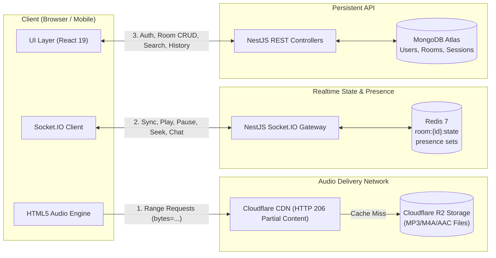

# Kiến Trúc Hệ Thống & Đồng Bộ Realtime (System Architecture & Realtime Sync Engine)

> **Cốt lõi sản phẩm**: "Cùng nghe một giai điệu, cùng lúc, bất kể khoảng cách địa lý."  
> Bản đặc tả này xác lập cơ chế đồng bộ âm thanh có độ trễ cực thấp, khả năng chịu lỗi mạng và phân định ranh giới tải hệ thống.

---

## 1. Sơ Đồ Phân Định Trách Nhiệm (System Boundaries)

Hệ thống phân tách thành 3 luồng dữ liệu độc lập nhằm tối ưu hóa tải CPU, mạng và trải nghiệm người dùng:



| Kênh truyền tải | Giao thức | Phạm vi trách nhiệm |
| :--- | :--- | :--- |
| **Audio Stream** | HTTP/2 Range Request | Phân phối file âm thanh chất lượng cao trực tiếp từ CDN tới trình duyệt; **không đi qua backend**. |
| **Realtime Engine** | WebSocket (Socket.IO) | Đồng bộ trạng thái phát nhạc (Play/Pause/Seek), Presence (ai đang online), Chat và Thả Emoji. |
| **REST API** | HTTPS / JSON | Đăng nhập/Đăng ký, tạo/sửa phòng, lịch sử nghe nhạc, tìm kiếm catalog. |

---

## 2. Vòng Lặp Trải Nghiệm Cốt Lõi (The Core User Loop)

```
[1. Khám phá (Discover)]
         │
         ▼
[2. Thấy bạn bè / phòng đang phát nhạc (Live Indicator)]
         │
         ▼
[3. Bấm nút CTA: 🎧 LISTEN TOGETHER]
         │
         ▼
[4. Gia nhập phòng (Join Room & Socket Handshake)]
         │
         ▼
[5. Đồng bộ vị trí phát nhạc tức thì (Sync State < 250ms)]
         │
         ▼
[6. Trải nghiệm xã hội (Chat thời gian thực, thả cảm xúc nổi)]
         │
         ▼
[7. Lưu bài hát yêu thích / Chia sẻ phòng ra bên ngoài]
```

---

## 3. Thuật Toán Đồng Bộ Âm Thanh (Audio Synchronization Engine)

### 3.1. Nguyên Tắc Server là Single Source of Truth
Client không bao giờ tự ý quyết định vị trí phát nhạc của phòng. Khi Host thực hiện thao tác (Play, Pause, Seek, Đổi bài), một sự kiện được gửi lên Server. Server cập nhật state vào Redis, sinh **Version mới** và broadcast lại cho toàn bộ thành viên trong phòng.

### 3.2. Chống Race Condition bằng State Versioning
Mỗi thay đổi trạng thái trong phòng đều đi kèm một số nguyên tự tăng `version` ($v \to v + 1$):

```typescript
export interface PlaybackState {
  roomId: string;
  trackId: string;
  isPlaying: boolean;
  positionMs: number;      // Vị trí tại thời điểm server ghi nhận
  serverTimestamp: number; // Mốc thời gian Unix Epoch (ms) của Server
  version: number;         // Tăng dần: 101 -> 102 -> 103
  speed: number;           // Mặc định 1.0
}
```

* **Quy tắc Client**: Khi nhận được gói tin trạng thái, nếu `payload.version <= currentVersion`, client lập tức bỏ qua (discard) để tránh việc các gói tin đến trễ ghi đè lên trạng thái mới hơn.

### 3.3. Công Thức Tính Vị Trí Phát Tại Client
Do độ trễ mạng (Network Latency), khi gói tin đến được máy người nghe, bài hát đã chạy tiếp một khoảng thời gian. Client tính toán vị trí bài hát thực tế theo công thức:

$$\text{TargetPositionMs} = \begin{cases} \text{positionMs} + (\text{now}() - \text{serverTimestamp}), & \text{khi } \text{isPlaying} = \text{true} \\ \text{positionMs}, & \text{khi } \text{isPlaying} = \text{false} \end{cases}$$

### 3.4. Thuật Toán Triệt Tiêu Độ Lệch (Drift Correction Algorithm: $\Delta t \le 250\text{ms}$)
Mỗi 2 giây (hoặc sau khi buffer xong), client so sánh vị trí của audio element với mục tiêu:

$$\Delta t = |\text{localAudio.currentTime} \times 1000 - \text{TargetPositionMs}|$$

```
              ĐỘ LỆCH THỜI GIAN (Delta_t)
   0ms                     100ms                  250ms
────┴───────────────────────┴──────────────────────┴────────────────────>
    [  HOÀN TOÀN ĐỒNG BỘ  ]   [   ĐIỀU CHỈNH MỀM   ]  [    HARD SEEK    ]
    Giữ nguyên tốc độ         Tăng/giảm tốc độ       Nhảy thẳng audio
    playbackRate = 1.00       0.98x hoặc 1.02x       về đúng TargetMs
    (Tai người không nhận     (Mượt mà, không giật
     thấy sự khác biệt)        tiếng, không khựng)
```

1. **Vùng an toàn ($\Delta t \le 100\text{ms}$)**: Được xem là đồng bộ hoàn hảo. Giữ nguyên `playbackRate = 1.0`.
2. **Vùng điều chỉnh mềm ($100\text{ms} < \Delta t \le 250\text{ms}$)**: 
   - Nếu client chạy chậm hơn server: Thiết lập `playbackRate = 1.02` trong 2-3 giây để bắt kịp mà người nghe không nhận ra sự thay đổi cao độ âm thanh.
   - Nếu client chạy nhanh hơn server: Thiết lập `playbackRate = 0.98`.
3. **Vùng lệch lớn ($\Delta t > 250\text{ms}$)**: Buộc phải thực hiện **Hard Seek** (`audio.currentTime = TargetPositionMs / 1000`) để đảm bảo không bị rớt lại phía sau.

---

## 4. Danh Mục Sự Kiện Realtime (Realtime Event Catalog)

Toàn bộ sự kiện tuân thủ chặt chẽ định nghĩa trong [`packages/realtime-contracts`](file:///d:/soundwithme/soundwithme/packages/realtime-contracts/src/events.ts):

### 4.1. Room & Member Events
- `room:join`: Client yêu cầu tham gia phòng (gửi `roomId`).
- `room:leave`: Client thông báo rời phòng.
- `room:member_joined`: Server broadcast thành viên mới vào phòng.
- `room:member_left`: Server broadcast thành viên rời phòng.
- `room:host_changed`: Server thông báo chuyển quyền Host cho người khác.
- `room:closed`: Phòng đã kết thúc (do Host đóng hoặc rời phòng).

### 4.2. Playback Events
- `playback:play`: Host kích hoạt phát nhạc từ vị trí `positionMs`.
- `playback:pause`: Host tạm dừng nhạc.
- `playback:seek`: Host tua nhạc đến vị trí mới.
- `playback:change_track`: Đổi sang bài hát mới.
- `playback:state`: Server broadcast snapshot trạng thái đầy đủ kèm `version`.

### 4.3. Queue Events
- `queue:add`: Thêm bài hát vào danh sách chờ.
- `queue:remove`: Xóa bài hát khỏi danh sách chờ.
- `queue:updated`: Danh sách chờ được cập nhật cho toàn bộ phòng.

### 4.4. Social Events (Chat & Reactions)
- `chat:message`: Gửi và nhận tin nhắn trò chuyện trong phòng (được lưu vào DB).
- `reaction:send` & `reaction:broadcast`: **Transient Animation** (Thả emoji trái tim, lửa, nốt nhạc). 
  - **Lưu ý kiến trúc**: Emoji chỉ broadcast qua Socket.IO để hiển thị hiệu ứng bay lơ lửng trên màn hình người nghe; **TUYỆT ĐỐI KHÔNG GHI VÀO MONGODB** để tránh nghẽn I/O database.

---

## 5. Hiện Diện & Cơ Chế Khôi Phục Kết Nối (Presence & Failover Engine)

### 5.1. Grace Period 15 Giây
Khi người dùng di chuyển vào thang máy, đổi mạng Wi-Fi sang 4G hoặc làm mới tab trình duyệt, kết nối WebSocket có thể bị gián đoạn.
- Server **không xóa thành viên ngay lập tức**.
- Một Timer **15 giây (Grace Period)** được kích hoạt trên Redis key `presence:room:{roomId}:{userId}`.
- Nếu client kết nối lại và gửi `room:join` trong vòng 15 giây, trạng thái được tái lập ngay lập tức mà không làm xáo trộn số lượng thành viên hay quyền hạn.

### 5.2. Tự Động Chuyển Giao Quyền Host (Automatic Host Failover)
Khi Host của phòng bị ngắt kết nối:
1. Hệ thống đếm ngược 15 giây Grace Period.
2. Nếu sau 15 giây Host không quay lại:
   - **Phòng Công Khai (Public Room)**: Server tự động chuyển giao quyền Host (`room:host_changed`) cho thành viên đang online có thời gian tham gia phòng lâu nhất (`oldest joined member`).
   - **Phòng Riêng Tư (Private Room)**: Nếu không có cấu hình kế vị, phòng sẽ được đánh dấu đóng (`status: "closed"`) và thông báo `room:closed` gửi tới các thành viên còn lại.
