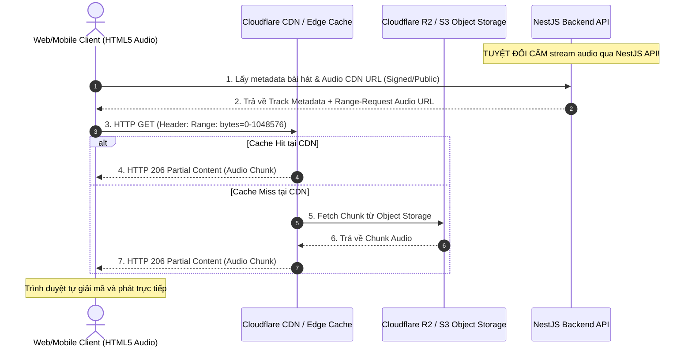

# Quy Chuẩn Công Nghệ (Tech Stack Standards) — SoundWithMe

> **Sứ mệnh**: "Music connects us wherever you are"  
> **Nguyên tắc kỹ thuật tối thượng**: *Build for real users, not screenshots.*  
> **Thứ tự ưu tiên**: **Correctness > Security > Maintainability > UX > Performance > Scalability**

---

## 1. Cấu Trúc Monorepo (Turborepo + pnpm Workspace)

SoundWithMe được tổ chức dưới dạng monorepo chuẩn hóa cao, phân định ranh giới nghiêm ngặt giữa các ứng dụng chạy độc lập (`apps/`) và các thư viện chia sẻ (`packages/`).

```
soundwithme/
├── apps/
│   ├── web/                    # Next.js 15 (App Router, React 19)
│   ├── api/                    # NestJS 10 (Modular Monolith, Socket.IO)
│   └── mobile/                 # React Native / Expo (Phase 4 - Reserved)
├── packages/
│   ├── types/                  # Domain Types, Data Contracts (TypeScript)
│   ├── validation/             # Zod Schemas cho API DTO & Form Validation
│   ├── constants/              # System Constants, Socket Events, Error Codes
│   ├── realtime-contracts/     # Typed Socket.IO Client <-> Server Contracts
│   ├── ui/                     # Shared Design Tokens (Colors, Typography, Spacing)
│   └── config/                 # Shared Configs (ESLint, TSConfig, Prettier)
├── infrastructure/             # Dockerfiles, Nginx, Deployment scripts
├── docs/                       # Architecture Decision Records (ADR), specs
└── .agents/rules/              # Bộ quy chuẩn phát triển tự động
```

### Quy Tắc Build Bất Biến (Invariant Build Rule)
1. **Packages Compile-First**: Mọi package trong `packages/*` (`types`, `validation`, `constants`, `realtime-contracts`, `ui`) **bắt buộc** phải được biên dịch ra thư mục `dist/` trước khi `apps/api` khởi chạy hoặc build.
2. **Turborepo Dependency Graph**:
   - `apps/api#build` phụ thuộc vào `^build` của các packages nội bộ.
   - `apps/web#build` phụ thuộc vào `^build` của các packages nội bộ.
3. Khi thay đổi bất kỳ file nào trong `packages/*`, phải chạy `pnpm build` hoặc chế độ watch tương ứng để cập nhật `dist/`. Tuyệt đối không import trực tiếp từ file `.ts` nội bộ của package khác nếu package đó phát hành qua entry point `dist/`.

---

## 2. Frontend Stack Quy Chuẩn (`apps/web`)

| Thành phần | Công nghệ / Thư viện | Quy chuẩn triển khai |
| :--- | :--- | :--- |
| **Framework** | Next.js 15 (App Router) | Sử dụng React Server Components (RSC) cho layout và dữ liệu tĩnh; `"use client"` chỉ khi cần interactivity, hook, hoặc DOM event. |
| **UI Library** | React 19 | Tận dụng Actions, `useActionState`, `useOptimistic` khi thích hợp. |
| **Styling** | Tailwind CSS v4 | Sử dụng class utility kết hợp semantic tokens; tuyệt đối không dùng inline CSS tùy tiện. |
| **Component Kit** | shadcn/ui | Headless components dựa trên Radix UI, tùy biến theo token màu của SoundWithMe. |
| **Server State** | TanStack Query v5 | Quản lý 100% dữ liệu từ REST API (cache, deduplication, polling, mutation, optimistic updates). |
| **Client / Realtime State** | Zustand | **Chỉ dùng** cho UI local state, trạng thái Audio Player (time, buffer, volume, mute) và Socket.IO connection. |
| **Icons** | Lucide React | Sử dụng icon đồng bộ kích thước và stroke-width. |

---

## 3. Backend Stack Quy Chuẩn (`apps/api`)

| Thành phần | Công nghệ / Thư viện | Quy chuẩn triển khai |
| :--- | :--- | :--- |
| **Framework** | NestJS 10 | Kiến trúc **Modular Monolith**. Các module (`auth`, `users`, `rooms`, `music`, `playback`) tách biệt rõ ràng. |
| **Realtime Gateway** | Socket.IO v4 + `@socket.io/redis-adapter` | Adapter Redis được kích hoạt ngay từ bootstrap để sẵn sàng mở rộng đa node. |
| **Persistent DB** | MongoDB Atlas (Mongoose 8+) | Lưu trữ dữ liệu bền vững: Users, Refresh Tokens, Rooms, Member History, Listening Sessions. |
| **Ephemeral DB / Cache** | Redis 7 (ioredis) | Lưu trữ trạng thái tạm thời: Room Playback State, Room Presence (member sets), Throttling, Distributed Locks. |
| **Security & Auth** | Passport.js, JWT, bcrypt (12 rounds) | Stateless Access Token (15 phút) + Stateful Refresh Token Rotation (7 ngày) lưu hash trong MongoDB. |
| **Rate Limiting** | `@nestjs/throttler` | Giới hạn 120 req/phút toàn hệ thống; cấu hình gắt hơn (5 req/phút) cho Auth endpoints. |

---

## 4. Audio Pipeline & Quy Tắc Bất Biến (Audio Range-Request Rule)



### ⚠️ QUY TẮC CẤM STREAM AUDIO QUA BACKEND (CRITICAL)
1. **CẤM stream binary audio qua NestJS Backend**: NestJS API chỉ đóng vai trò cấp phát metadata, quyền hạn và URL stream.
2. **Lý do kỹ thuật**:
   - Audio streaming qua Node.js event loop gây nghẽn I/O, cạn kiệt RAM và làm chậm phản hồi WebSocket của các phòng nghe khác.
   - Trình duyệt cần cơ chế **HTTP 206 Partial Content (Range Requests)** để seek nhanh đến bất kỳ giây nào mà không phải tải toàn bộ file.
3. **Giải pháp chuẩn**: Toàn bộ file nhạc (`.mp3`, `.m4a`, `.aac`) lưu trữ tại **Cloudflare R2 / AWS S3** và phân phối qua **Cloudflare CDN Edge Caching**. Trình duyệt gọi trực tiếp CDN với header `Range: bytes=start-end`.

---

## 5. Trừu Tượng Hóa MusicProvider (`MusicProvider` Interface)

Hệ thống SoundWithMe không phụ thuộc cứng vào bất kỳ nguồn nhạc cụ thể nào. Mọi nhà cung cấp (Spotify, Apple Music, Youtube Music hoặc Mock Catalog nội bộ) đều phải tuân thủ hợp đồng (`MusicProvider` interface) trong `@soundwithme/types`:

```typescript
export interface MusicProvider {
  /** Tìm kiếm bài hát theo từ khóa */
  search(query: string, limit?: number): Promise<Track[]>;

  /** Lấy chi tiết một bài hát theo ID của provider */
  getTrack(providerTrackId: string): Promise<Track | null>;

  /** Lấy thông tin nghệ sĩ */
  getArtist(providerArtistId: string): Promise<Artist | null>;

  /** Lấy thông tin album */
  getAlbum(providerAlbumId: string): Promise<Album | null>;

  /** Xác thực năng lực phát nhạc của bài hát */
  getPlaybackCapabilities(providerTrackId: string): Promise<{
    supportsRangeRequests: boolean;
    supportsHls: boolean;
  }>;
}
```

* **Môi trường Dev / Test**: Sử dụng [`MockMusicProvider`](file:///d:/soundwithme/soundwithme/apps/api/src/modules/music/providers/mock-music.provider.ts) với danh mục tĩnh để phát triển UI, Rooms và Queue mà không phụ thuộc API key ngoài.
* **Môi trường Production**: Khởi tạo implementation tương ứng qua cơ chế Dependency Injection (NestJS Custom Provider token `MUSIC_PROVIDER`) dựa trên cấu hình môi trường.
